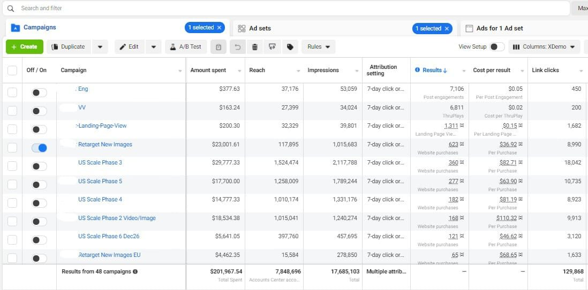
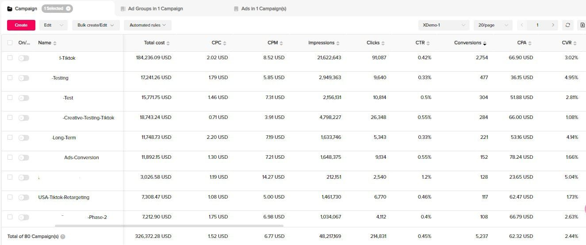
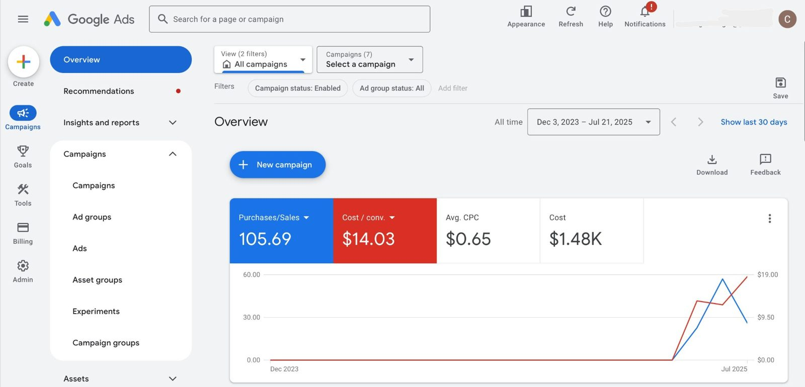
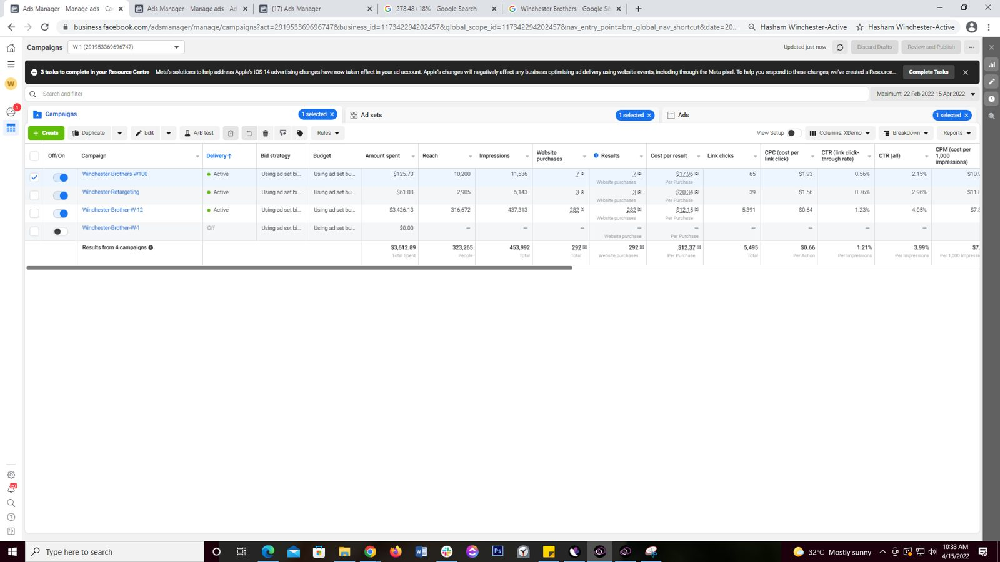
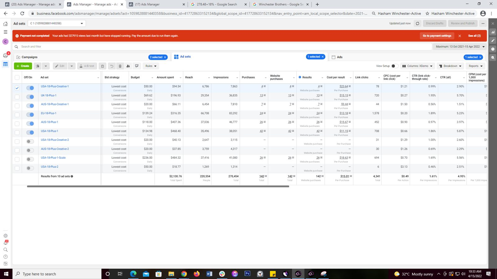
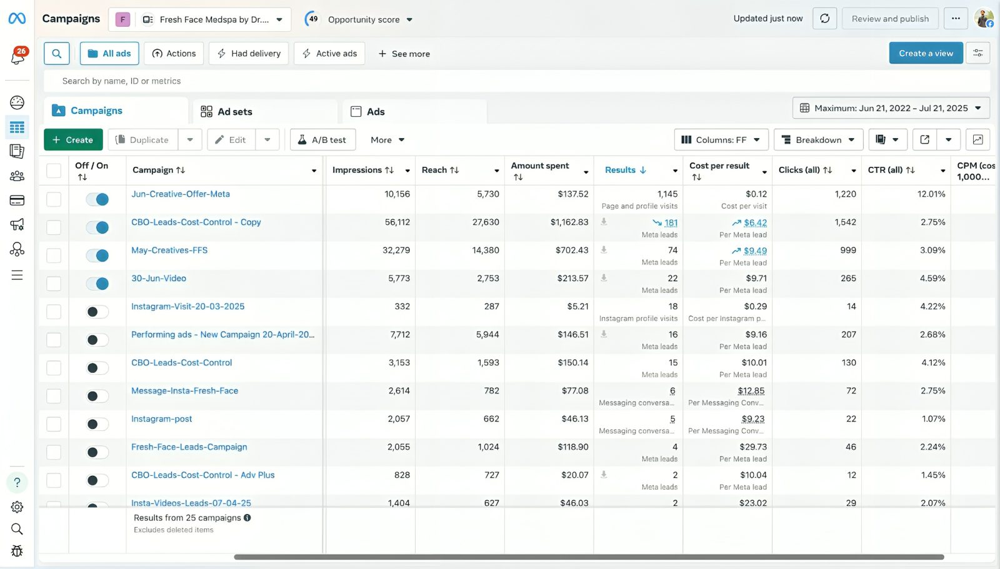
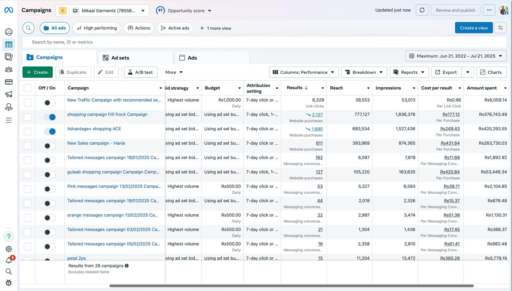

# Performance Marketing Portfolio: Ali Raza

**Senior Performance Marketing Specialist · Meta & Google Ads Media Buyer**  
Lahore, Pakistan (Remote) · +92 304 5998268 · [LinkedIn](https://www.linkedin.com/in/ali-raza-ads-manager/) · [raza44474@gmail.com](mailto:raza44474@gmail.com) · [Website](https://ali-raza-ppc.github.io)

Paid acquisition for e-commerce, DTC, SaaS and lead-generation businesses. Meta and Google course-certified, with 6+ years of full-funnel media buying, creative testing, server-side tracking and budget scaling.

| Metric | Value |
|---|---|
| Cumulative paid media managed | **$10M+** |
| Best ROAS achieved | **Up to 6x** |
| Experience | **6+ years, 6 ad platforms** |
| Brands scaled | **15+ across US/EU markets** |

---

## Case studies

> Client names are kept confidential. Figures come from live accounts I managed.

### 1. Premium US e-commerce brand: +47% monthly revenue
- **Challenge:** Grow revenue on a $4K–$6K/day budget across Meta, Google Shopping and other channels.
- **Approach:** Audience segmentation, structured creative testing (50+ ad variations a month), funnel optimisation and budget reallocation toward winning segments.
- **Results:**
  - **+47%** monthly revenue
  - **~4.2x ROAS** on remarketing and DPA sequences
  - **23%** of abandoned carts recovered
  - **+31% CTR** and **−22% CPC**

### 2. Multi-client acquisition (e-commerce, SaaS, services): −35% CAC
- **Challenge:** Lower acquisition cost across Meta, Google, TikTok, Snapchat and LinkedIn without hurting lead quality.
- **Approach:** Full-funnel Meta acquisition and remarketing, plus creative, copy and landing-page testing frameworks. Planned US and UAE market entry for HRMS and car-rental SaaS, including Click-to-WhatsApp lead gen.
- **Results:**
  - **−35%** average CAC
  - **+28%** conversion rate across key accounts

### 3. US/EU e-commerce portfolio: up to $40K/day in spend
- **Challenge:** Scale paid social for a portfolio of e-commerce brands.
- **Approach:** Meta, TikTok and Snapchat scaling, with reporting on CAC, LTV, ROAS and funnel performance.
- **Results:**
  - Up to **$200K+** in daily attributed revenue
  - Portfolio ROAS typically **3–4x**, peaking around **5x**

### 4. Apparel retail (Pakistan): 6x ROAS
- Facebook, Snapchat and TikTok campaigns on a PKR 1M monthly budget reached **6x ROAS**.

### 5. GCC lead generation: sales-team lead automation
- Meta and Google Ads lead-form campaigns for GCC clients.
- Built a Google Sheets lead automation with **round-robin allocation across a 7-person sales team**.

---

## Ad account screenshots

| Meta Ads: $201,967 spend, 48 campaigns | TikTok Ads: $326,372 spend, 5,237 conversions |
|---|---|
|  |  |
| **Google Ads: 105.69 purchases at $14.03 each** | **Meta: 292 purchases at $12.37 each** |
|  |  |
| **Meta: 142 purchases at $15.01 each** | **Meta lead gen: 181 leads at $6.42 each** |
|  |  |
| **Meta (Pakistan): 2,127 purchases at Rs177.12 each** | |
|  | |

---

## How I work

1. **Tracking first:** Meta Pixel, Conversions API, server-side tracking, GA4 and GTM, so the platforms optimise on clean data.
2. **Full-funnel structure:** TOF/MOF/BOF with Advantage+ Shopping, DPA/catalogue and lookalikes.
3. **Structured creative testing:** test concepts, hooks, messaging, formats and audiences, then turn the insights into new iterations.
4. **Scale on profit:** optimise for ROAS and POAS, not just volume.
5. **Clear reporting:** weekly reports with week-over-week comparisons, ad-level diagnostics and prioritised action plans.

## Skills

| Area | Tools & methods |
|---|---|
| Ad platforms | Meta (Facebook & Instagram), Google Ads (Search, Shopping, Lead Forms), TikTok, Snapchat, LinkedIn |
| Media buying | Advantage+ Shopping, DPA/catalogue, prospecting & retargeting, lead gen, lookalikes, budget scaling |
| Creative | Hook/angle/format testing, UGC, ad copy, structured A/B testing |
| Tracking & data | Meta Pixel, Conversions API, server-side tracking, GA4, GTM, attribution, Excel/Google Sheets |
| E-commerce & CRM | Shopify, CRM and lead-sheet integrations, landing-page optimisation |

## Services

- [Meta ads expert for Shopify & DTC brands](https://ali-raza-ppc.github.io/meta-ads-expert-for-shopify/)
- [TikTok ads freelancer for e-commerce](https://ali-raza-ppc.github.io/tiktok-ads-freelancer/)
- [Google Ads & Meta lead generation for service businesses](https://ali-raza-ppc.github.io/google-ads-lead-generation/)
- [Hire a remote PPC specialist (US hours)](https://ali-raza-ppc.github.io/hire-remote-ppc-specialist/)

## Experience

| Role | Company | Dates |
|---|---|---|
| Performance Marketing Specialist | _space A/S (Denmark, remote) | Mar 2026 – Present |
| Performance Marketing Specialist | TechHive AI | Mar 2025 – Mar 2026 |
| Digital Marketing Specialist | First Manufacturing Company (US) | Jan 2024 – Feb 2025 |
| Digital Marketing Specialist (Part-time) | Mentor Pakistan | Jan 2023 – Jan 2024 |
| Digital Marketing Specialist | ABN Overseas Education | Nov 2022 – Dec 2023 |
| Social Media Marketing Manager & Data Analyst | Exoah Ltd | Nov 2019 – Nov 2022 |

## Certifications & education

- Meta: Introduction to Social Media Marketing (Coursera course certificate)
- Google: Foundations of Digital Marketing and E-commerce (Coursera course certificate)
- Degree in Resource Economics, University of Agriculture, Faisalabad

---

📩 **Open to new projects and roles:** [raza44474@gmail.com](mailto:raza44474@gmail.com) · [LinkedIn](https://www.linkedin.com/in/ali-raza-ads-manager/)
